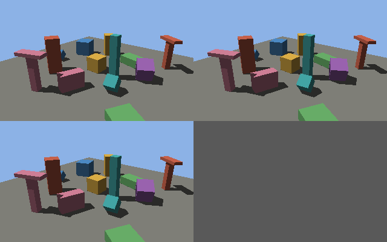

# web-rayquery

A personal prototype for hardware ray tracing (RT cores) on web pages: expose [wgpu](https://github.com/gfx-rs/wgpu)'s experimental ray queries to WebGPU in a locally built Firefox, behind a pref. Firefox runs WebGPU on wgpu, and wgpu already implements ray queries on DX12, Vulkan and Metal, so the work is mostly letting web pages reach them. A page would feature-detect it and fall back to a compute-shader ray tracer in normal browsers.

Background: [gpuweb#535](https://github.com/gpuweb/gpuweb/issues/535) (ray tracing in WebGPU).

## Status

| Phase | What | State |
|---|---|---|
| 0 | Check wgpu/Firefox support; run wgpu ray queries natively | Done |
| 1 | Build Firefox unmodified | Done |
| 2 | Pref-gated ray query API in Firefox (WebIDL, dom/webgpu, IPC, wgpu_bindings) | Done (Windows, DX12) |
| 3 | Test page (plain WebGPU) tracing rays vs a software result | Done |
| 4 | Write-up | Maybe |
| 5 | Everything wgpu and the GPU can do: Vulkan, ray tracing pipelines on DX12 and Vulkan, NVIDIA ray tracing and tensor-core extensions, bindless, mesh shaders and more | Done (Windows; see its known problems) |

## Phase 0 findings (October 2026)

- wgpu 30.0.0 exposes `Features::EXPERIMENTAL_RAY_QUERY` on DX12 (raytracing tier 1.1 + SM 6.5), Vulkan (`VK_KHR_ray_query`) and Metal (macOS 15 / iOS 18). Full ray tracing pipelines are Vulkan only. Experimental features need `ExperimentalFeatures::enabled()` at device creation.
- naga translates `enable wgpu_ray_query;` to HLSL `RayQuery` (cs_6_5, DXC with `-HV 2018`), SPIR-V `SPV_KHR_ray_query`, and MSL `metal::raytracing::intersection_query` (MSL 2.4+). Examples: [`wgpu-rq-test/naga-out/`](wgpu-rq-test/naga-out/).
- Firefox main vendors wgpu 30.0.0 at commit `49325ca0`, uses DX12 on Windows by default (pref `dom.webgpu.wgpu-backend` can select `vulkan`), and ships its own `dxcompiler.dll`.
- What blocks web pages today (from reading the source; not yet patched):
  - Firefox creates its wgpu instance with `STRICT_WEBGPU_COMPLIANCE`, which hides native features and zeroes the acceleration-structure limits.
  - Device creation only passes WebGPU features and disables experimental features.
  - The content-to-GPU-process layer (`wgpu-core-remote`) has no create/build commands for acceleration structures, and its bind group layouts can't hold one.
  - No WebIDL for any of it.

## Phase 1 findings (October 2026)

- Full (non-artifact) build of Firefox `main` at `9fcf3a1690ec` (Firefox 161 Nightly) on Windows 11 with MozillaBuild 4.2.1, following the [Windows build docs](https://firefox-source-docs.mozilla.org/setup/windows_build.html). `./mach build` took 29 min on a 20-core desktop CPU, no errors.
- Bootstrap fetched Mozilla's own clang-cl, MSVC/SDK package and `dxcompiler.dll`; configure found DXC, so WebGPU is enabled.
- [`pages/webgpu-check.html`](pages/webgpu-check.html) (adapter, features, compute round trip) passes in the build. The GPU process loads `d3d12.dll` + `dxcompiler.dll` and no `vulkan-1.dll`: WebGPU runs on **DX12** by default. `adapter.info` fields are blank (Firefox hides them).
- `--setpref dom.webgpu.wgpu-backend=vulkan` does switch wgpu to Vulkan (wgpu logs `backend: Vulkan`), but the same check then fails ("Buffer unmapped") and the log shows GPU-process `AbnormalShutdown` messages. Not investigated at the time; fixed in Phase 5.
- Notes: mach limits its terminal output when it detects an AI agent (full log in `obj-*/.mozbuild/logs/build/`). Firefox prints page `console.log` to stdout with `--setpref devtools.console.stdout.content=true`, and honours `RUST_LOG` for wgpu logs.

## Phase 2: the Firefox patch (October 2026)

The patch now comes in two parts (since Phase 5), both against Firefox `main` at `9fcf3a1690ec`: [`firefox-patch/webgpu-native-features.patch`](firefox-patch/webgpu-native-features.patch) (Firefox's own code) and [`firefox-patch/wgpu-vendored.patch`](firefox-patch/wgpu-vendored.patch) (the vendored wgpu crates; see Phase 5).

```
cd firefox
git apply /path/to/webgpu-native-features.patch /path/to/wgpu-vendored.patch
./mach build
./mach run --setpref dom.webgpu.experimental-ray-query.enabled=true
```

Cargo doesn't notice edits to git-pinned vendored crates, so after changing them delete their entries under `obj-*/x86_64-pc-windows-msvc/release/.fingerprint/` before building.

With the pref off (the default) Firefox behaves as before: the API below is not exposed and the feature is never offered.

### JavaScript API (prototype)

```js
const adapter = await navigator.gpu.requestAdapter();
if (!adapter.features.has('experimental-ray-query')) { /* fall back to a compute-shader tracer */ }
const device = await adapter.requestDevice({ requiredFeatures: ['experimental-ray-query'] });

const vertexBuffer = device.createBuffer({ size, usage: GPUBufferUsage.VERTEX | GPUBufferUsage.COPY_DST | GPUBufferUsage.BLAS_INPUT });
const blas = device.createBlas({ geometries: [{ vertexFormat: 'float32x3', vertexCount: 3 }] }); // optional indexFormat, indexCount, opaque
const tlas = device.createTlas({ maxInstances: 1 });

const encoder = device.createCommandEncoder();
encoder.buildAccelerationStructures(
  [{ blas, geometries: [{ vertexBuffer, vertexStride: 12 }] }],     // optional firstVertex, indexBuffer, firstIndex
  [{ tlas, instances: [{ blas, customData: 7 }] }],                   // optional transform (12 numbers, row-major 3x4), mask
);
// Bind group layout entry: { binding, visibility, accelerationStructure: {} }; bind group entry: { binding, resource: tlas }
```

WGSL uses wgpu's extension: `enable wgpu_ray_query;`, `var acc: acceleration_structure;`, `ray_query`, `rayQueryInitialize`, `rayQueryProceed`, `rayQueryGetCommittedIntersection`. The names (`GPUBlas`, `GPUTlas`, `BLAS_INPUT`) follow wgpu, not any WebGPU proposal.

### How it works

- **Pref** `dom.webgpu.experimental-ray-query.enabled` (read once at startup).
- **GPU process** (`gfx/wgpu_bindings/src/server.rs`): with the pref on, wgpu's instance is created without `STRICT_WEBGPU_COMPLIANCE`, which otherwise hides the feature and zeroes the acceleration structure limits. A device that asks for the feature is created directly with wgpu-core (Firefox's wrapper always disables experimental features), with `ExperimentalFeatures::enabled()` and the adapter's acceleration structure limits. BLAS/TLAS objects live in tables next to wgpu's own, and bind groups and builds that use them are assembled from wgpu-core's public API.
- **IPC** (`lib.rs`, `client.rs`): new messages to create, build, bind and drop acceleration structures; adapters report whether ray queries are on offer.
- **DOM** (`dom/webidl/WebGPU.webidl`, `dom/webgpu/`): the API above. `GPUBufferUsage.BLAS_INPUT` (0x40000000, a bit WebGPU doesn't use) becomes wgpu's native `BufferUsages::BLAS_INPUT`, which BLAS build inputs need.

### Verified

On the RTX 5070 (Windows 11, DX12), with [`pages/rayquery-smoke.html`](pages/rayquery-smoke.html) (the Phase 0 scene, written against the JS API):

- Pref on: the adapter offers `experimental-ray-query`, and the page builds a BLAS and a TLAS, then traces 256 rays in a compute shader. 50 hits, identical to the CPU trace (0 mismatches, max hit-distance error 0) and to the native Phase 0 run. The GPU process loaded `d3d12.dll` and `dxcompiler.dll`, not Vulkan.
- Pref on: the plain [`webgpu-check.html`](pages/webgpu-check.html) still passes; the feature list gains only `experimental-ray-query`.
- Pref off: the check passes, the feature is absent, and `createBlas`/`buildAccelerationStructures` are undefined.
- Incremental rebuilds after the patch took about 7 minutes.

### Not done or not checked

- No BLAS/TLAS updates or compaction (except partitioned TLASes, Phase 5), and no `destroy()` (objects are freed when garbage-collected). Phase 5 added AABB and sphere geometries, transform buffers, build flags and vertex return.
- A build whose geometry count differs from the BLAS's throws a `TypeError` instead of a WebGPU validation error. An unknown BLAS/TLAS in a build is only logged in the GPU process.
- Turning the pref on drops strict WebGPU compliance for every page, not just ones using ray queries. Known effects: an adapter can create more than one device, and wgpu's extra `max_buffers_and_acceleration_structures_per_shader_stage` limit (28 by default) applies.
- Not hardened. wgpu marks ray queries as experimental, and this exposes them to web content. Keep the pref off for normal browsing.
- Not tested: Linux, macOS, workers, Firefox's own test suites or the WebGPU CTS. Rust changes were not run through rustfmt. (Vulkan: see Phase 5.)

## Phase 5: everything wgpu and the GPU can do (October 2026)

Goal: give pages everything wgpu and the driver can do on the GPU, on both DX12 and Vulkan, behind the same pref, whether or not a page uses it yet. Some of it goes beyond wgpu (NVIDIA's newer ray tracing and tensor-core extensions); those parts were added to the vendored wgpu crates.

### Backends

- **Vulkan works.** Firefox crashed its GPU process on purpose for any non-DX12 device on Windows (`D3D12 backend device on windows`, from a DX12 fence it asks every new device for). Those spots now skip DX12-only work. Pick Vulkan with `dom.webgpu.wgpu-backend=vulkan`.
- **Zero-copy Vulkan canvases.** Vulkan renders into the same D3D11 shared textures the compositor uses (imported with `VK_KHR_external_memory_win32`, with the device fence shared through `VK_KHR_external_semaphore_win32`), instead of copying each frame back to the CPU.
- **Ray tracing pipelines on DX12 too.** wgpu only had them on Vulkan. Each stage is compiled to its own DXIL library (`lib_6_x`, DXC) and linked into a D3D12 state object with hit groups, a global root signature, shader and pipeline configs; shader identifiers fill the shader tables, and `DispatchRays` traces. naga's HLSL backend gained the ray tracing stages: payloads, callable data and hit attributes travel in wrapper structs, built-ins become intrinsics (`DispatchRaysIndex()`, `ObjectToWorld4x3()`, ...), and `traceRay` / `reportIntersection` / `executeCallable` / `ignoreIntersection` / `terminateRay` become `TraceRay` / `ReportHit` / `CallShader` / `IgnoreHit` / `AcceptHitAndEndSearch`. `traceRaysIndirect` uses `ExecuteIndirect`, with the shader table part of the arguments written on the GPU.

### wgpu features

- **Native features by name.** Pages ask for wgpu's own feature names (`"wgpu-shader-int64"`, `"wgpu-ray-tracing-pipelines"`, ...); `EXPOSED_NATIVE_FEATURES` in `gfx/wgpu_bindings/src/server.rs` lists the ones offered. Standard `"subgroups"` and `"primitive-index"` are switched on too (Firefox keeps them off upstream), and the proposed `"immediates"`.
- **Ray tracing pipelines** (the open upstream pull request [gfx-rs/wgpu#10144](https://github.com/gfx-rs/wgpu/pull/10144), extended): `device.createRayTracingPipeline({layout, rayGeneration, miss: [...], intersections: [{closestHit, anyHit?, intersection?}], callables: [...], maxRecursionDepth})`, `encoder.beginRayTracingPass()`, `pass.traceRays(w, h, d)` and `pass.traceRaysIndirect(buffer, offset)`. WGSL: `traceRay(acc, desc, &payload, sbtOffset, sbtStride, missIndex)`, several miss shaders, `@intersection` shaders on AABB BLASes with `reportIntersection(t, kind)`, `@callable` shaders with `executeCallable(index, &data)`, `ignoreIntersection()`, `terminateRay()`. BLASes take transform buffers and build flags; TLAS instances take flags and an `intersectionIndex` (hit group).
- **Shader execution reordering**: WGSL `traceRayReordered(acc, desc, &payload, hint?, hintBits?)` regroups rays by what they hit before shading (Vulkan `VK_NV_ray_tracing_invocation_reorder`; on DX12 it needs Shader Model 6.9, see below).
- **Pipeline caches**: `device.createPipelineCache({data?})`, `cache.getData()`, `cache` on pipeline descriptors (Vulkan).
- **Bindless**: `count` on a bind group layout entry, and an array of samplers, texture views, buffer bindings or TLASes as the bind group resource.
- **64-bit texture atomics**: `r64uint` storage textures with `access: "atomic"`.
- **Mesh shaders**: `device.createMeshPipeline({task?, mesh, fragment, ...})`, `pass.drawMeshTasks()`, `drawMeshTasksIndirect()`.
- **Multi-draw**: `multiDrawIndirect`, `multiDrawIndexedIndirect`, and the `...Count` versions that read the draw count from a GPU buffer.
- **Immediates**: `immediateSize` on pipeline layouts and `setImmediates()` on passes.
- Also: multiview (`multiviewMask`), wireframe and point polygon modes, conservative rasterization, 16-bit normalized formats, texture swizzles, border colours, `clearTexture`, timestamps inside encoders and passes, pipeline statistics queries.

### Beyond wgpu: NVIDIA ray tracing (Vulkan)

- **Opacity micromaps** (`VK_EXT_opacity_micromap`, `"wgpu-opacity-micromap"`): `device.createOpacityMicromap({usageCounts})`, `encoder.buildOpacityMicromaps(...)`, then a triangle geometry's `opacityMicromap` in a BLAS build; the `DISABLE_OPACITY_MICROMAPS` instance flag.
- **Motion blur** (`VK_NV_ray_tracing_motion_blur`, `"wgpu-ray-tracing-motion-blur"`): `allowMotion` BLASes with `motionVertexBuffer`, instances with `motionTransform`; WGSL `traceRayMotion(acc, desc, &payload, time)` and the `ray_time` built-in.
- **Spheres and linear swept spheres** (`VK_NV_ray_tracing_linear_swept_spheres`, `"wgpu-ray-tracing-spheres"`): sphere and capsule-chain geometries for particles, hair and curves (`endCaps` default on).
- **RTX Mega Geometry** (`VK_NV_cluster_acceleration_structure`, `VK_NV_partitioned_acceleration_structure`): GPU-driven builds from argument arrays in Vulkan's layouts, which refer to buffers and BLASes by device address (`device.getDeviceAddresses([buffer or blas, ...])`, `device.getClusterAccelerationStructureBuildSizes(input)`).
  - Clusters: `encoder.buildClusterAccelerationStructuresIndirect({operation: "build-triangle-cluster" | "build-clusters-bottom-level" | ..., mode, srcInfos, dstImplicitData, dstAddresses, dstSizes, ...})`.
  - Partitioned TLASes: `device.createTlas({maxInstances, partitioned: {partitionCount, maxInstancePerPartitionCount}})`, `encoder.buildPartitionedAccelerationStructure({tlas, update?, srcInfos, srcInfosCount})`, bound with `accelerationStructure: {partitioned: true}`. Updates rewrite only the instances they list, in place.

### Beyond wgpu: tensor cores (Vulkan)

- **Cooperative vectors** (`VK_NV_cooperative_vector`, `"wgpu-cooperative-vector"`): WGSL `coopVecMatMul` / `coopVecMatMulAdd` multiply a small array by a matrix in a storage buffer, for small neural networks inside shaders. `encoder.convertCooperativeVectorMatrices([...])` converts matrices on the GPU to the hardware's `"inferencing-optimal"` layout and to float8 (`"float8-e4m3"`, `"float8-e5m2"`); an optional last WGSL argument reads the input as float8 too. `device.getCooperativeVectorMatrixSize(desc)` and `device.getCooperativeVectorProperties()` (the supported type combinations).
- **Cooperative matrices with bf16 and float8** (`VK_KHR_shader_bfloat16`, `VK_EXT_shader_float8`, under `"wgpu-cooperative-matrix"`): WGSL element types `bf16`, `f8e4m3` and `f8e5m2` for `coop_mat` A and B operands, 32-wide shapes (`coop_mat32x16`, `coop_mat16x32`, ...), and loads/stores that reinterpret another array's memory (the stride counts that array's elements). naga gained three scalar kinds for them, valid only as cooperative matrix elements.

Fixes to wgpu found on the way (in `wgpu-vendored.patch`):
- naga's HLSL output wrote 64-bit literals as `123uL`/`123L`, which DXC in HLSL 2018 mode (what wgpu uses, with warnings off) reads as 32-bit: 64-bit constants silently lost their top half on DX12. Now `ull`/`ll`.
- naga's module compaction dropped a ray tracing stage's incoming payload, so any ray tracing module with more than one entry point crashed the GPU process. Also present in the upstream pull request.
- DX12 multi-draw with a GPU count: wgpu always used its plain command signature there, so `vertex_index` and `instance_index` missed each draw's `firstVertex`/`firstInstance`. The arguments are now rewritten with the per-draw constants.
- naga's SPIR-V output copied a whole array to a temporary before each read with a runtime index, even when the array was a constant or a function argument and so could not have changed. Babylon.js's soft-shadow (PCSS) sample tables, read 48 times per call, made the game's scene pass take 22 ms per frame on Vulkan against 3 ms on DX12 (1280x843), so the game ran at 39 fps on Vulkan. Such arrays are now copied once per call, at the start of the function: the pass takes 1.2 ms and the game runs at 60 fps on both backends. Upstream wgpu still copies on every read (trunk, 30 October 2026).

### Verified (RTX 5070, Windows 11, NVIDIA 617.42)

Every page, on both backends, in the final build. "Not offered" means the adapter doesn't advertise the feature on that backend and the page skips it.

| Test page | DX12 | Vulkan |
|---|---|---|
| Features offered (Firefox upstream: 14) | 50 | 72 |
| [`webgpu-check`](pages/webgpu-check.html), [`rayquery-smoke`](pages/rayquery-smoke.html), [`rayquery-boxes`](pages/rayquery-boxes.html) | pass | pass |
| [`native-features`](pages/native-features.html): subgroups, 64-bit integers and atomics, 16-bit integers, f64, f32 atomics, barycentrics, draw index and more | all offered pass (f64, f32 atomics, draw index, subgroup barrier and vertex, early depth test not offered) | all 13 pass |
| [`bindless-atomics`](pages/bindless-atomics.html): binding array of 8 textures; `textureAtomicMax` on `r64uint` | pass | pass |
| [`mesh-multidraw`](pages/mesh-multidraw.html): task + mesh shader; multi-draw with a GPU-written count; immediates | pass | pass |
| [`extras`](pages/extras.html): wireframe, conservative rasterization, 16-bit norm, swizzle, border colour, `clearTexture`, timestamps in passes, pipeline statistics | pass (pipeline statistics not offered) | pass |
| [`vertex-multiview`](pages/vertex-multiview.html): multiview; hit vertex positions | multiview pass (vertex return not offered) | pass |
| [`pipeline-cache`](pages/pipeline-cache.html) | not offered | pass: 12 pipelines take 1278 ms cold, 61 ms with a loaded cache |
| [`rt-pipeline`](pages/rt-pipeline.html): two hit groups, a miss shader, `traceRaysIndirect` | pass (4096/4096) | pass (4096/4096) |
| [`rt-complete`](pages/rt-complete.html): shader binding table arguments, several miss shaders, intersection shaders on AABBs, callables, any-hit ignore/terminate, instance flags | pass (6336/6336) | pass (6336/6336) |
| [`ser`](pages/ser.html): 1024x1024 scattered rays, reordered vs plain | images match; 1.00x (no Shader Model 6.9) | images match; 5.1x faster (5.04 ms to 0.99 ms) |
| [`opacity-micromap`](pages/opacity-micromap.html), [`motion-blur`](pages/motion-blur.html), [`spheres`](pages/spheres.html) | not offered | pass |
| [`cooperative-vector`](pages/cooperative-vector.html): matrix multiplies; conversion to optimal f16 and e4m3 | not offered | pass (4096/4096 each) |
| [`coop-matrix`](pages/coop-matrix.html): f16, bf16, e4m3 and e5m2 multiply-adds | not offered | pass (256/256 each) |
| [`mega-geometry`](pages/mega-geometry.html): partitioned TLAS build and in-place update; clusters, cluster BLAS, partitioned TLAS | not offered | pass |
| [`present-rate`](pages/present-rate.html): 1280x843 canvas | 60.5 fps | 60.5 fps |

Known problems and limits:
- **DX12 shader execution reordering** needs Shader Model 6.9 (`dx::HitObject`, `dx::MaybeReorderThread`). The DXC Firefox ships (1.9) supports it, but this Windows build's D3D12 runtime stops at 6.8, so `traceRayReordered` traces normally on DX12 (correct images, no speed-up). The code path is written but unverified. wgpu can load a newer D3D12 Agility SDK: set `WGPU_DX12_AGILITY_SDK_PATH` and `WGPU_DX12_AGILITY_SDK_VERSION` before starting Firefox (the SDK is a separate download from Microsoft).
- DX12 has no motion blur, spheres, opacity micromaps (DXR 1.2's are not wired up), Mega Geometry, cooperative vectors or cooperative matrices here: those features are only offered on Vulkan.
- GPU-driven builds (Mega Geometry) trust their argument arrays: wgpu tracks the buffers named in a call, not the buffers and BLASes the arguments address, so a page must keep those alive and correct.
- Not done: `VK_NV_cooperative_matrix2` (workgroup-scope and flexible-size matrices, tensor layouts, reductions), int8 cooperative matrices (offered by the driver; naga has no 8-bit integers), device-generated commands, and naga backends other than SPIR-V for the bf16/float8 types.
- DX12 (DXC): a task payload struct with a single member fails DXC validation ("Bitcast on struct types is not allowed"); add a second member.
- Vulkan: Babylon's built-in video copy shader fails to compile (it needs external textures, which wgpu only has on DX12).

## Phase 3: boxes compared with software (October 2026)

[`pages/rayquery-boxes.html`](pages/rayquery-boxes.html) traces one scene three ways and compares them pixel by pixel:

1. **Hardware** ray queries through the Phase 2 API (skipped when the browser doesn't offer `experimental-ray-query`).
2. **Software on the GPU:** a plain WebGPU compute shader that tests every triangle (brute force, no acceleration structure). This is the kind of fallback a page would use in normal browsers.
3. **CPU reference** in 64-bit JavaScript.

The scene has a ground slab, 12 boxes (indexed `uint16` cube BLAS, instanced with rotations and non-uniform scales) and two "T" shapes (a second BLAS with two non-indexed geometries in one vertex buffer, the second at `firstVertex: 36`). That is 15 TLAS instances and 204 triangles. Each of the 320x200 pixels gets a primary ray and a shadow ray towards a directional light. For every pixel the page compares hit or miss, instance custom data and index, geometry index, primitive index, distance, barycentrics, front face and shadow. Rays that pass within 1e-4 (barycentric) of a triangle edge are counted separately, because rounding can legitimately change their answer.



*Top left: hardware ray queries. Top right: software compute shader. Bottom left: CPU reference. Bottom right: differences (all grey = every pixel agrees).*

Results in the patched Firefox on the RTX 5070 (DX12):

| | Hardware vs CPU | Software vs CPU |
|---|---|---|
| Rays (primary, plus a shadow ray per hit) | 64,000 (40,250 hits) | 64,000 (40,250 hits) |
| Mismatches | 0 | 0 |
| Edge-grazing rays that differ | 0 of 5,834 | 0 of 5,834 |
| Max hit distance error | 1.3e-5 m | 1.3e-5 m |
| Max barycentric error | 1.1e-5 | 1.3e-5 |
| Front-face disagreements | 0 | 0 |

With the pref off, the same page skips the hardware path and the software tracer still matches the CPU (0 mismatches).

### Timing (rough)

A second scene with 401 instances (4,812 triangles) at 640x400, primary plus shadow rays, measured with GPU timestamp queries (median of 5):

| | GPU time per frame |
|---|---|
| Software, brute force | 14.3 to 17.5 ms |
| Hardware ray queries | 0.030 to 0.041 ms |

Ranges cover four runs. That is roughly 350x to 580x, or 9 to 12 billion rays per second on this scene. The hardware result for this scene matched the software one except on 36 of 256,000 rays (edge cases). Caveats: brute force is a weak baseline (a software tracer with a BVH would be much faster), the scene is tiny and coherent, and timings varied run to run. Wall-clock time is no use here: in this Firefox build `onSubmittedWorkDone` resolved on a ~100 ms cycle.

## wgpu-rq-test

Rust program using wgpu at the same commit Firefox vendors. A compute shader with `enable wgpu_ray_query;` fires a 16x16 grid of rays at one triangle, reads the hits back and compares them with a CPU (Moller-Trumbore) trace.

```
cd wgpu-rq-test
cargo run -- all        # or dx12 / vulkan
```

DX12 loads `dxcompiler.dll` from `C:\VulkanSDK\1.4.357.0\Bin` if present (set `DXC_PATH` to use another).

Result on an RTX 5070 (driver 617.42, Windows 11): DX12 and Vulkan both pass, no differences from the CPU trace ([`phase0-run.txt`](wgpu-rq-test/phase0-run.txt)). Not measured: performance, or whether the driver runs these queries on the RT cores.

## License

MIT OR Apache-2.0, at your option (same as wgpu).
